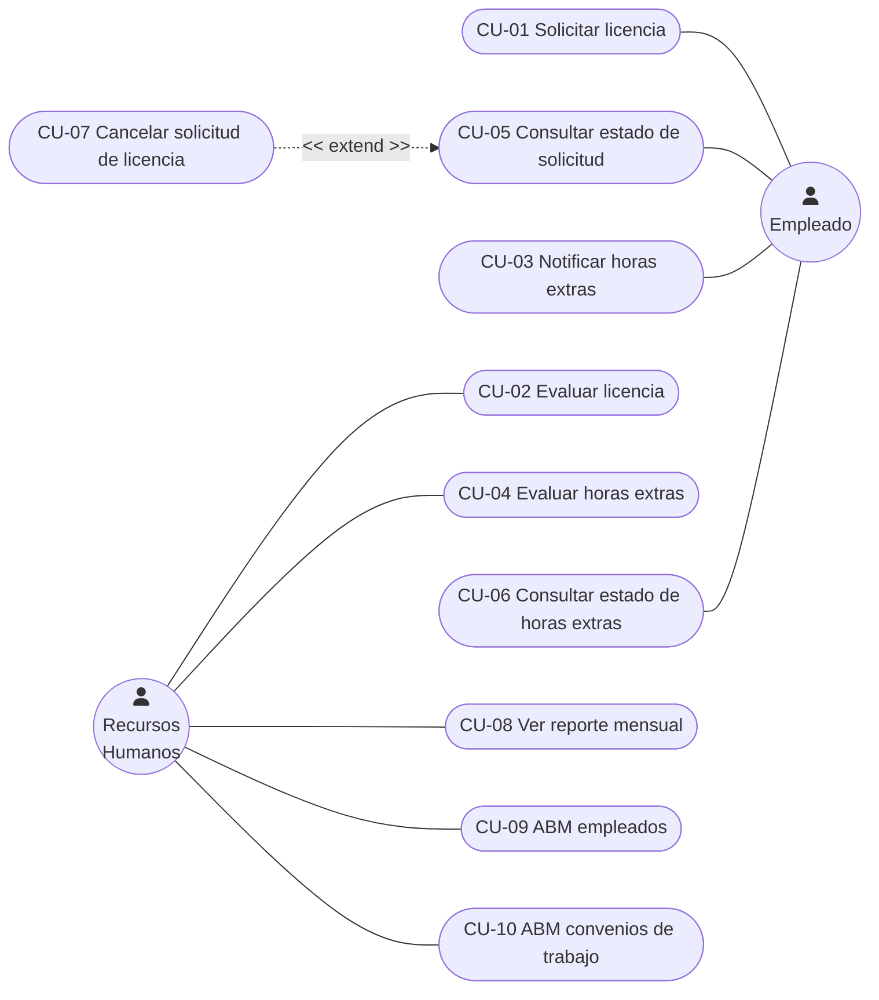

# Casos de uso

- [CU-01 Solicitar licencia](#cu-01-solicitar-licencia)
- [CU-02 Evaluar licencia](#cu-02-evaluar-licencia)
- [CU-03 Notificar horas extras](#cu-03-notificar-horas-extras)
- [CU-04 Evaluar horas extras](#cu-04-evaluar-horas-extras)
- [CU-05 Consultar estado de solicitud](#cu-05-consultar-estado-de-solicitud)
- [CU-06 Consultar estado de horas extras](#cu-06-consultar-estado-de-horas-extras)
- [CU-07 Cancelar solicitud de licencia](#cu-07-cancelar-solicitud-de-licencia)
- [CU-08 Ver reporte mensual](#cu-08-ver-reporte-mensual)
- [CU-09 ABM empleados](#cu-09-abm-empleados)
- [CU-10 ABM convenios de trabajo](#cu-10-abm-convenios-de-trabajo)

## Diagrama de casos de uso

## CU-01 Solicitar licencia

Permite al empleado generar una solicitud formal de licencia a través del sistema, indicando el tipo de licencia, el rango de fechas (fecha de inicio y fin) y el motivo de la misma ([RF-02](requerimientos.md#rf-02)).

El sistema valida la solicitud contra las reglas del convenio de trabajo asociado al legajo del empleado ([CU-10](#cu-10-abm-convenios-de-trabajo)): tipos de licencia admitidos por su convenio, días disponibles según la estrategia de cupo configurada, antelación mínima requerida y cantidad de días mínimos y máximos consecutivos. El cálculo contempla automáticamente días hábiles, fines de semana y feriados nacionales.

Asimismo, el sistema verifica que el rango solicitado no se superponga con otra solicitud pendiente o aprobada del empleado, y que no pertenezca a un período mensual cuyo reporte ya haya sido cerrado. La solicitud queda registrada en estado 'Pendiente' para su posterior evaluación por parte de Recursos Humanos ([CU-02](#cu-02-evaluar-licencia)). El empleado puede consultar el estado de su trámite en cualquier momento ([CU-05](#cu-05-consultar-estado-de-solicitud)) y cancelarlo mientras no haya sido resuelto y su fecha de inicio no haya transcurrido ([CU-07](#cu-07-cancelar-solicitud-de-licencia)).

- **Actores**
  - Empleado (primario)
  - Sistema (secundario: validación de reglas de convenio y cálculo de días y saldos)

- **Referencias a otros CU**
  - [CU-02 Evaluar licencia](#cu-02-evaluar-licencia)
  - [CU-05 Consultar estado de solicitud](#cu-05-consultar-estado-de-solicitud)
  - [CU-07 Cancelar solicitud de licencia](#cu-07-cancelar-solicitud-de-licencia)
  - [CU-10 ABM convenios de trabajo](#cu-10-abm-convenios-de-trabajo)

### Flujo normal

| Usuario | Sistema | Observaciones |
| :--- | :--- | :--- |
| Accede al módulo 'Solicitudes de licencia' y selecciona la opción 'Nueva solicitud'. | Presenta el formulario con los tipos de licencia disponibles según el convenio del empleado y los campos de fecha de inicio, fecha de fin y motivo. | Los tipos de licencia ofrecidos corresponden al convenio asignado al empleado. |
| Selecciona el tipo de licencia. | Muestra la información contextual según el convenio: saldo de días disponibles, antelación mínima y restricciones de días consecutivos. | El saldo se obtiene en tiempo real según la estrategia de la licencia. |
| Completa las fechas de inicio y de fin, e ingresa el motivo. | Calcula automáticamente la cantidad de días hábiles solicitados, verifica que el saldo sea suficiente, valida la antelación mínima requerida y comprueba que no existan superposiciones ni períodos cerrados. | El cálculo contempla fines de semana y feriados nacionales. |
| Confirma el envío de la solicitud. | Registra la solicitud en estado 'Pendiente', genera su identificador único de seguimiento y confirma la operación al usuario. | La solicitud queda disponible en la bandeja de gestión de RRHH. |
| Visualiza la confirmación. | Muestra el resumen de la solicitud registrada y permite volver a la consulta de estado ([CU-05](#cu-05-consultar-estado-de-solicitud)). | |

### Flujo alternativo #1: Saldo de días insuficiente

| Usuario | Sistema | Observaciones |
| :--- | :--- | :--- |
| Selecciona un tipo de licencia con cupo y completa las fechas. | Detecta que los días hábiles solicitados superan el saldo disponible del empleado. Muestra: 'Saldo disponible: X días. Días solicitados: Y días. No es posible continuar'. | Regla definida en la estrategia de la licencia ([CU-10](#cu-10-abm-convenios-de-trabajo)). |
| Ajusta el rango de fechas o cancela la carga. | Vuelve al formulario conservando los datos ya ingresados para que el empleado los corrija. | |

### Flujo alternativo #2: Superposición con otra licencia

| Usuario | Sistema | Observaciones |
| :--- | :--- | :--- |
| Selecciona fechas que se superponen con una licencia ya aprobada o con una solicitud pendiente. | Detecta el conflicto de fechas, muestra el mensaje de superposición e impide registrar la solicitud hasta que se seleccione un rango sin conflictos. | No se genera ningún registro nuevo. |

## CU-02 Evaluar licencia

Permite al área de Recursos Humanos revisar y resolver las solicitudes de licencia pendientes enviadas por los empleados ([RF-03](requerimientos.md#rf-03)). RRHH puede aprobar o rechazar una solicitud; en caso de rechazo, el ingreso de una observación o motivo es obligatorio.

Al resolverse la solicitud, el sistema actualiza su estado a 'Aprobada' o 'Rechazada'. Si la solicitud es aprobada, los días computados se descuentan automáticamente del cálculo dinámico del saldo del empleado y las fechas quedan consolidadas para el reporte mensual ([CU-08](#cu-08-ver-reporte-mensual)). El empleado puede consultar el resultado y las observaciones ingresadas directamente desde su consulta de estado ([CU-05](#cu-05-consultar-estado-de-solicitud)).

Sólo los usuarios con rol RRHH acceden a este caso de uso ([RNF-01](requerimientos.md#rnf-01)).

- **Actores**
  - RRHH (primario)
  - Sistema (secundario: actualización de estado y cómputo de saldo de días disponibles)

- **Referencias a otros CU**
  - [CU-01 Solicitar licencia](#cu-01-solicitar-licencia)
  - [CU-05 Consultar estado de solicitud](#cu-05-consultar-estado-de-solicitud)
  - [CU-08 Ver reporte mensual](#cu-08-ver-reporte-mensual)

### Flujo normal

| Usuario | Sistema | Observaciones |
| :--- | :--- | :--- |
| Accede al módulo 'Licencias'. | Verifica el rol RRHH y muestra el listado de solicitudes pendientes. | Permite filtrar por estado, empleado, convenio y período. |
| Selecciona una solicitud mediante la acción 'Evaluar'| Muestra los datos completos: empleado, legajo, tipo de licencia, motivo, rango de fechas, días hábiles solicitados y saldo de días disponible. | Consulta en tiempo real el saldo dinámico del empleado. |
| Revisa la información y selecciona la acción 'Aprobar'. | Habilita el campo de observación opcional. | |
| Confirma la decisión. | Actualiza el estado de la solicitud a 'Aprobada', registra la resolución y descuenta los días del saldo disponible del empleado. | El empleado puede visualizar la aprobación en su panel. |
| Vuelve al listado de solicitudes. | Actualiza el listado de solicitudes reflejando el nuevo estado. | |

### Flujo alternativo #1: Solicitud con fechas ya vencidas

| Usuario | Sistema | Observaciones |
| :--- | :--- | :--- |
| Evalúa una solicitud cuyo rango de fechas ya transcurrió en el calendario. | Advierte que las fechas de la solicitud ya han vencido y que la resolución quedará asentada como histórica. | |
| Confirma la decisión. | Registra la resolución histórica y la computa en el período correspondiente. | |

### Flujo alternativo #2: Solicitud cancelada por el empleado

| Usuario | Sistema | Observaciones |
| :--- | :--- | :--- |
| Selecciona una solicitud que fue cancelada por el empleado ([CU-07](#cu-07-cancelar-solicitud-de-licencia)). | Informa que la solicitud fue cancelada por el empleado e impide registrar una nueva decisión sobre ella. | El estado 'Cancelada' es terminal. |

### Flujo alternativo #3: Rechazo sin observación

| Usuario | Sistema | Observaciones |
| :--- | :--- | :--- |
| Selecciona 'Rechazar' y confirma sin completar el campo de observación. | Bloquea la confirmación e indica que la observación es estrictamente obligatoria para rechazar una solicitud. | Exigencia de validación de negocio ([RF-03](requerimientos.md#rf-03)). |
| Ingresa el motivo del rechazo y confirma. | Actualiza el estado a 'Rechazada' y asienta la observación ingresada. | No se descuentan días del saldo del empleado. |

## CU-03 Notificar horas extras

Permite al empleado declarar formalmente las horas trabajadas por fuera de su jornada habitual, indicando la fecha, el horario de inicio y fin, y el motivo de la extensión horaria ([RF-04](requerimientos.md#rf-04)).

A partir de los datos ingresados, el sistema calcula automáticamente la cantidad de horas trabajadas y determina los tramos y multiplicadores aplicables según el convenio de trabajo del empleado ([CU-10](#cu-10-abm-convenios-de-trabajo)), diferenciando horas al 50% (días hábiles) y al 100% (sábados a partir de las 13:00 hs, domingos y feriados nacionales) ([RF-01](requerimientos.md#rf-01)). Si la extensión abarca un cambio de condición horaria, el sistema divide y desglosa automáticamente los tramos correspondientes. De acuerdo con el alcance definido, el sistema no calcula montos de dinero: sólo registra la cantidad de horas y el multiplicador aplicable.

El sistema valida que el horario declarado no pertenezca al futuro, que la hora de fin sea posterior a la de inicio, que no existan superposiciones con otras notificaciones del empleado en el mismo día y que el período mensual no se encuentre cerrado. La notificación queda registrada en estado 'Pendiente' para su posterior evaluación por parte de Recursos Humanos ([CU-04](#cu-04-evaluar-horas-extras)).

- **Actores**
  - Empleado (primario)
  - Sistema (secundario: cálculo de tramos horarios y asignación de multiplicadores según convenio)

- **Referencias a otros CU**
  - [CU-04 Evaluar horas extras](#cu-04-evaluar-horas-extras)
  - [CU-06 Consultar estado de horas extras](#cu-06-consultar-estado-de-horas-extras)
  - [CU-10 ABM convenios de trabajo](#cu-10-abm-convenios-de-trabajo)

### Flujo normal

| Usuario | Sistema | Observaciones |
| :--- | :--- | :--- |
| Accede al módulo 'Notificación horas extra' y selecciona 'Nueva notificación'. | Presenta el formulario con los campos: fecha, hora de inicio, hora de fin y motivo. | Por defecto sugiere la fecha actual. |
| Completa la fecha y el rango horario trabajado. | Calcula en tiempo real las horas trabajadas y determina el desglose por multiplicador según el día y el horario. | Contempla feriados nacionales y el corte del sábado al mediodía. |
| Verifica el resumen calculado e ingresa el motivo de la labor. | Muestra el desglose de tramos y la suma total de horas a notificar. | |
| Confirma el envío. | Valida que el horario no esté en el futuro ni superpuesto, registra la notificación en estado 'Pendiente' y confirma la operación. | Queda visible para revisión de RRHH ([CU-04](#cu-04-evaluar-horas-extras)). |

### Flujo alternativo #1: Superposición con otra notificación

| Usuario | Sistema | Observaciones |
| :--- | :--- | :--- |
| Declara un rango horario que se superpone con una notificación previa registrada para la misma fecha. | Detecta el conflicto de intervalos horarios, muestra el mensaje de superposición y bloquea el guardado. | No se genera ningún registro nuevo. |

## CU-04 Evaluar horas extras

Permite al área de Recursos Humanos revisar y resolver las notificaciones de horas extra enviadas por los empleados, aprobándolas o rechazándolas ([RF-05](requerimientos.md#rf-05)). En caso de rechazo, el sistema exige de forma obligatoria el ingreso de un motivo u observación.

Al aprobarse una notificación, el sistema registra la fecha de aprobación y las horas quedan consolidadas en el acumulado del empleado para el período correspondiente, incorporándose al reporte mensual ([CU-08](#cu-08-ver-reporte-mensual)).

Sólo los usuarios con rol RRHH acceden a este caso de uso ([RNF-01](requerimientos.md#rnf-01)).

- **Actores**
  - RRHH (primario)
  - Sistema (secundario: registro de fecha de aprobación y cómputo de acumulados)

- **Referencias a otros CU**
  - [CU-03 Notificar horas extras](#cu-03-notificar-horas-extras)
  - [CU-06 Consultar estado de horas extras](#cu-06-consultar-estado-de-horas-extras)
  - [CU-08 Ver reporte mensual](#cu-08-ver-reporte-mensual)

### Flujo normal

| Usuario | Sistema | Observaciones |
| :--- | :--- | :--- |
| Accede al módulo 'Horas'. | Verifica el rol RRHH y muestra el listado de notificaciones pendientes. | Permite filtrar por estado, empleado, período y alertas de tope mensual. |
| SSelecciona una solicitud mediante la acción 'Evaluar | Muestra: empleado, fecha, rango horario, horas calculadas, multiplicador aplicable, motivo y horas acumuladas por el empleado en el mes. | Advierte visualmente si el empleado supera el tope mensual de horas. |
| Revisa la información y selecciona la acción 'Aprobar'. | Habilita el campo opcional de observación. | |
| Confirma la decisión. | Actualiza el estado a 'Aprobada', registra la fecha de aprobación e incorpora las horas al reporte del período. | El empleado puede visualizar la aprobación en su panel ([CU-06](#cu-06-consultar-estado-de-horas-extras)). |

### Flujo alternativo #1: Rechazo de la notificación

| Usuario | Sistema | Observaciones |
| :--- | :--- | :--- |
| Selecciona la acción 'Rechazar' e intenta confirmar sin ingresar una observación. | Bloquea la confirmación e indica que la observación es obligatoria para rechazar la notificación. | |
| Ingresa el motivo del rechazo y confirma. | Actualiza el estado a 'Rechazada' y asienta la observación para consulta del empleado. | Las horas no se computan en el reporte mensual. |

## CU-05 Consultar estado de solicitud

Permite al empleado consultar el historial completo de sus solicitudes de licencia y el estado actual de cada una: Pendiente, Aprobada, Rechazada o Cancelada, junto con las fechas, días calculados y las observaciones ingresadas por RRHH al resolverlas ([RF-06](requerimientos.md#rf-06)).

Este caso de uso no permite modificar los datos de la solicitud original. Desde el detalle o listado de una solicitud pendiente o aprobada cuya fecha de inicio aún no haya transcurrido, el empleado puede extender el flujo hacia la cancelación ([CU-07](#cu-07-cancelar-solicitud-de-licencia)).

Por aplicación del control de acceso basado en roles, el empleado sólo puede visualizar sus propias solicitudes ([RNF-01](requerimientos.md#rnf-01)).

- **Actores**
  - Empleado (primario)

- **Referencias a otros CU**
  - [CU-01 Solicitar licencia](#cu-01-solicitar-licencia)
  - [CU-02 Evaluar licencia](#cu-02-evaluar-licencia)
  - [CU-07 Cancelar solicitud de licencia](#cu-07-cancelar-solicitud-de-licencia)

### Flujo normal

| Usuario | Sistema | Observaciones |
| :--- | :--- | :--- |
| Accede al módulo 'Solictudes de licencia'. | Recupera y muestra el listado de todas las solicitudes del empleado autenticado, ordenadas por identificador/fecha descendente, con el estado de cada una resaltado visualmente. | Pendiente, Aprobada, Rechazada o Cancelada. |
| Aplica filtros opcionales de búsqueda o estado. | Filtra los resultados mostrados en pantalla en tiempo real. | Permite ver rápidamente sólo pendientes, aprobadas, etc. |
| Visualiza el detalle de una solicitud. | Muestra tipo de licencia, rango de fechas, motivo ingresado por el empleado y motivo u observaciones de resolución de RRHH. | Si la solicitud no ha comenzado y está pendiente o aprobada, ofrece el botón de cancelación ([CU-07](#cu-07-cancelar-solicitud-de-licencia)). |

## CU-06 Consultar estado de horas extras

Permite al empleado consultar el historial de sus notificaciones de horas extra y el estado de cada una: Pendiente, Aprobada o Rechazada, junto con las observaciones registradas por RRHH ([RF-06](requerimientos.md#rf-06)).

Además del listado detallado, el sistema presenta métricas acumuladas con la cantidad de horas aprobadas en el período y los contadores por estado, permitiendo al empleado anticipar las horas que computarán en su liquidación.

Este caso de uso es de solo lectura y el empleado sólo visualiza sus propias notificaciones ([RNF-01](requerimientos.md#rnf-01)).

- **Actores**
  - Empleado (primario)

- **Referencias a otros CU**
  - [CU-03 Notificar horas extras](#cu-03-notificar-horas-extras)
  - [CU-04 Evaluar horas extras](#cu-04-evaluar-horas-extras)

### Flujo normal

| Usuario | Sistema | Observaciones |
| :--- | :--- | :--- |
| Accede al módulo 'Horas Extra'. | Muestra las métricas resumen (total de horas aprobadas, cantidad pendientes, aprobadas y rechazadas) y el listado de notificaciones ordenado descendentemente. | Solo computan en el total acumulado las horas aprobadas. |
| Aplica filtros de estado o búsqueda por texto. | Filtra el listado según el estado seleccionado o término de búsqueda. | |
| Revisa el detalle de una notificación. | Muestra: identificador, fecha, rango de horarios, cantidad de horas, tipo y multiplicador aplicado, estado y observaciones de resolución. | |

### Flujo alternativo #1: El empleado no tiene notificaciones previas

| Usuario | Sistema | Observaciones |
| :--- | :--- | :--- |
| Accede al módulo 'Mis Horas Extra'. | Muestra el listado vacío indicando que aún no se han registrado horas extra, con acceso directo al formulario de carga ([CU-03](#cu-03-notificar-horas-extras)). | |

## CU-07 Cancelar solicitud de licencia

Extiende a [CU-05](#cu-05-consultar-estado-de-solicitud). Permite al empleado dar de baja una solicitud de licencia que él mismo generó previamente, sin eliminar el registro del sistema a los fines de trazabilidad.

La cancelación está habilitada mientras la solicitud se encuentre en estado 'Pendiente', y siempre que la fecha de inicio de la licencia aún no haya llegado (debe ser estrictamente posterior a la fecha actual).

Al confirmar la cancelación, la solicitud pasa al estado terminal 'Cancelada', deja de computar en el descuento de saldo de licencias del empleado y se retira de la bandeja de pendientes de RRHH.

- **Actores**
  - Empleado (primario)
  - Sistema (secundario: actualización de estado y restitución del saldo de días disponibles)

- **Referencias a otros CU**
  - [CU-01 Solicitar licencia](#cu-01-solicitar-licencia)
  - [CU-02 Evaluar licencia](#cu-02-evaluar-licencia)
  - [CU-05 Consultar estado de solicitud](#cu-05-consultar-estado-de-solicitud)

### Flujo normal

| Usuario | Sistema | Observaciones |
| :--- | :--- | :--- |
| Desde el listado o detalle de una solicitud ([CU-05](#cu-05-consultar-estado-de-solicitud)), selecciona la opción 'Cancelar'. | Verifica que el estado admita cancelación (Pendiente) y que la fecha de inicio no haya llegado, presentando un diálogo de confirmación. | Solo cancelable antes del inicio de la licencia. |
| Confirma la acción de cancelación. | Actualiza el estado a 'Cancelada', restituye los días al saldo disponible del empleado y retira la solicitud de pendientes de RRHH. | El estado pasa a ser terminal. |
| Visualiza el resultado. | Muestra la confirmación de la cancelación y actualiza el listado. | |

### Flujo alternativo #1: Licencia ya iniciada o vencida

| Usuario | Sistema | Observaciones |
| :--- | :--- | :--- |
| Intenta cancelar una solicitud cuya fecha de inicio es igual o anterior a la fecha actual. | Bloquea la acción e informa: 'Solo se pueden cancelar solicitudes cuya fecha de inicio aún no haya llegado'. | No permite cancelar licencias en curso o pasadas. |

## CU-08 Ver reporte mensual

Permite al área de Recursos Humanos consultar y exportar el reporte mensual consolidado de horas extra y licencias por empleado, insumo de los procedimientos de liquidación de haberes ([RF-07](requerimientos.md#rf-07)).

El reporte presenta, para cada empleado en el período mensual seleccionado: las horas extra aprobadas discriminadas por tipo y multiplicador de remuneración, el total de horas extras acumuladas, y las licencias aprobadas agrupadas por tipo con la cantidad de días tomados en el mes. De acuerdo con el alcance definido, el sistema no calcula ni muestra montos de dinero: informa el desglose de horas y el multiplicador aplicable a cada una.

El sistema permite consultar tanto períodos cerrados (reportes consolidados persistidos en base de datos) como períodos abiertos o en curso (modo parcial en línea). Asimismo, RRHH puede exportar el reporte individual de liquidación por empleado en formato PDF ([RNF-05](requerimientos.md#rnf-05)). El acceso está restringido exclusivamente al rol RRHH ([RNF-01](requerimientos.md#rnf-01)).

- **Actores**
  - RRHH (primario)
  - Sistema (secundario: consolidación de horas y licencias, y generación del PDF)

- **Referencias a otros CU**
  - [CU-02 Evaluar licencia](#cu-02-evaluar-licencia)
  - [CU-04 Evaluar horas extras](#cu-04-evaluar-horas-extras)

### Flujo normal

| Usuario | Sistema | Observaciones |
| :--- | :--- | :--- |
| Accede al módulo 'Reportes' y define los parámetros: mes, año y, opcionalmente, empleado o convenio. | Verifica el rol RRHH y presenta los filtros de consulta. | Por defecto permite consultar períodos cerrados o en curso. |
| Presiona el botón 'Ver reporte'. | Recupera los datos consolidados del período o genera la consolidación en memoria si se consulta en modo parcial. | Sólo se computan registros en estado 'Aprobada'. |
| Visualiza el resumen en pantalla. | Muestra, por empleado: legajo, nombre, desglose de horas extra por multiplicador, total de horas reloj, y desglose de días de licencia por tipo con sus fechas efectivas. | |
| Selecciona un empleado e ingresa a la opción 'Exportar a PDF'. | Genera y descarga el archivo PDF de liquidación individual del empleado con el detalle de horas y licencias del período. | Exportación en PDF ([RNF-05](requerimientos.md#rnf-05)). |

### Flujo alternativo #1: Período sin registros aprobados

| Usuario | Sistema | Observaciones |
| :--- | :--- | :--- |
| Solicita la consulta de un período que no posee horas extras ni licencias aprobadas. | Informa que no se encontraron datos aprobados para procesar el informe en el período seleccionado. | No se genera archivo PDF. |

## CU-09 ABM empleados

Permite al personal de Recursos Humanos gestionar el padrón de legajos de la organización: el alta de nuevos empleados, la actualización de sus datos y la baja lógica de trabajadores.

En el alta se registra al empleado con su número de legajo (clave única de identificación), nombre y apellido, fecha de ingreso, área de trabajo, convenio colectivo asignado ([CU-10](#cu-10-abm-convenios-de-trabajo)) y su rol en el sistema (Empleado o RRHH), el cual define sus permisos de acceso mediante control de acceso por roles ([RNF-01](requerimientos.md#rnf-01)). El inicio de sesión se realiza mediante el legajo y contraseña.

Las bajas son lógicas (marcando el registro como inactivo): el registro no se elimina, preservando la trazabilidad histórica de solicitudes, notificaciones y reportes pasados ([RNF-04](requerimientos.md#rnf-04)). El sistema valida que el empleado no posea solicitudes de licencia ni notificaciones de horas extras pendientes de resolución antes de autorizar la baja lógica. Si un empleado inactivo reingresa, el sistema permite reactivar su legajo.

- **Actores**
  - RRHH (primario)
  - Sistema (secundario: validación de unicidad de legajo y comprobación de pendientes)

- **Referencias a otros CU**
  - [CU-10 ABM convenios de trabajo](#cu-10-abm-convenios-de-trabajo)

### Flujo normal

| Usuario | Sistema | Observaciones |
| :--- | :--- | :--- |
| Accede al módulo de Empleados y presiona 'Nuevo empleado'. | Muestra el formulario de alta con los campos: legajo, nombre y apellido, fecha de ingreso, área, convenio de trabajo y rol del sistema. | El listado de convenios proviene de [CU-10](#cu-10-abm-convenios-de-trabajo). |
| Completa los datos requeridos y confirma. | Valida que el legajo sea un número positivo, que no se encuentre registrado previamente y que los campos requeridos estén completos. | |
| Presiona 'Guardar'. | Registra el nuevo empleado en estado activo y confirma la operación. | El empleado queda habilitado para iniciar sesión y operar en el sistema. |

### Flujo alternativo #1: Modificación de datos

| Usuario | Sistema | Observaciones |
| :--- | :--- | :--- |
| Busca un empleado en el listado y presiona 'Editar'. | Muestra el formulario con los datos actuales del empleado. | |
| Modifica los campos necesarios (ej. área, convenio o nombre) y guarda. | Valida y actualiza los datos del empleado. | Si se cambia el convenio, las nuevas reglas aplican a solicitudes y notificaciones futuras. |

### Flujo alternativo #2: Baja lógica de empleado

| Usuario | Sistema | Observaciones |
| :--- | :--- | :--- |
| Selecciona un empleado activo y solicita darlo de baja. | Verifica si el empleado tiene solicitudes de licencia o notificaciones de horas extras pendientes de resolución. | |
| Si no tiene pendientes, solicita la confirmación de la baja. | Inhabilita el acceso del empleado pasando su estado a inactivo (`activo = false`), preservando su historial para reportes. | Si tiene pendientes, bloquea la baja hasta que sean resueltas. |

### Flujo alternativo #3: Legajo ya registrado

| Usuario | Sistema | Observaciones |
| :--- | :--- | :--- |
| Ingresa un número de legajo que ya existe en la base de datos. | Bloquea el alta e informa que el legajo ya se encuentra registrado. | Si el legajo pertenece a un empleado inactivo, ofrece la opción de reactivarlo. |

## CU-10 ABM convenios de trabajo

Permite a Recursos Humanos administrar los convenios de trabajo vigentes en la organización y las regulaciones de licencias y horas extra asociadas a cada uno ([RF-09](requerimientos.md#rf-09)).

El convenio centraliza la denominación y el estado activo/inactivo. A través de los módulos de configuración vinculados por convenio, se parametrizan los tipos de licencia admitidos (con sus estrategias de cupo anual, restricciones de días consecutivos y antelación mínima) y las horas extra con sus multiplicadores por tipo de día.

Las modificaciones sobre las regulaciones de licencias y horas extras se versionan mediante identificadores únicos (`codigo`), asegurando que las solicitudes y notificaciones resueltas en períodos anteriores conserven las condiciones vigentes al momento en que fueron procesadas, sin recalcular el historial.

- **Actores**
  - RRHH (primario)
  - Sistema (secundario: verificación de empleados asociados y versionado de regulaciones)

- **Referencias a otros CU**
  - [CU-01 Solicitar licencia](#cu-01-solicitar-licencia)
  - [CU-03 Notificar horas extras](#cu-03-notificar-horas-extras)
  - [CU-09 ABM empleados](#cu-09-abm-empleados)

### Flujo normal

| Usuario | Sistema | Observaciones |
| :--- | :--- | :--- |
| Accede al módulo 'Convenios' y selecciona 'Nuevo convenio'. | Presenta el formulario de carga con el campo de nombre del convenio. | |
| Ingresa el nombre y confirma. | Registra el nuevo convenio en estado activo y lo habilita para asociarle empleados ([CU-09](#cu-09-abm-empleados)) y configurar sus licencias y horas extras. | |
| Configura las licencias y horas extras asociadas al convenio. | Desde los submódulos correspondientes, define tipos de licencia con sus reglas de cupo y tipos de horas extra con sus multiplicadores. | Vinculados al convenio recién creado. |

### Flujo alternativo #1: Modificación de reglas de licencias u horas extras

| Usuario | Sistema | Observaciones |
| :--- | :--- | :--- |
| Selecciona una licencia u hora extra asociada al convenio y edita sus parámetros. | Si se modifican reglas o multiplicadores, genera una nueva versión inactiva de la anterior y crea la nueva fila activa conservando el mismo identificador de seguimiento. | Las solicitudes pasadas ya resueltas mantienen la versión con la que fueron aprobadas. |

### Flujo alternativo #2: Baja de un convenio con empleados asociados

| Usuario | Sistema | Observaciones |
| :--- | :--- | :--- |
| Selecciona un convenio e intenta darlo de baja. | Detecta si existen empleados activos asociados al convenio. | Si hay empleados activos, bloquea la baja indicando que deben reasignarse a otro convenio previamente. |
| Si no posee empleados activos, confirma la baja. | Marca el convenio como inactivo (`activo = false`). | |
